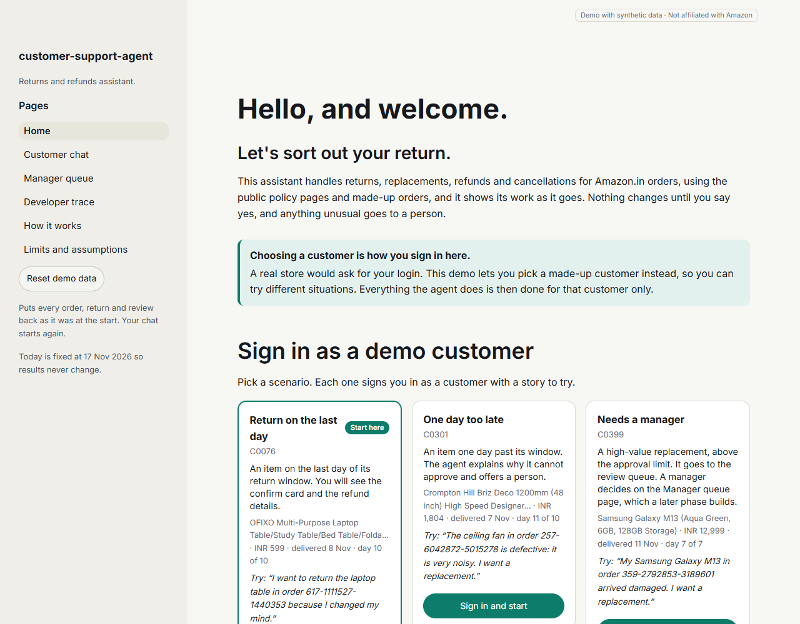
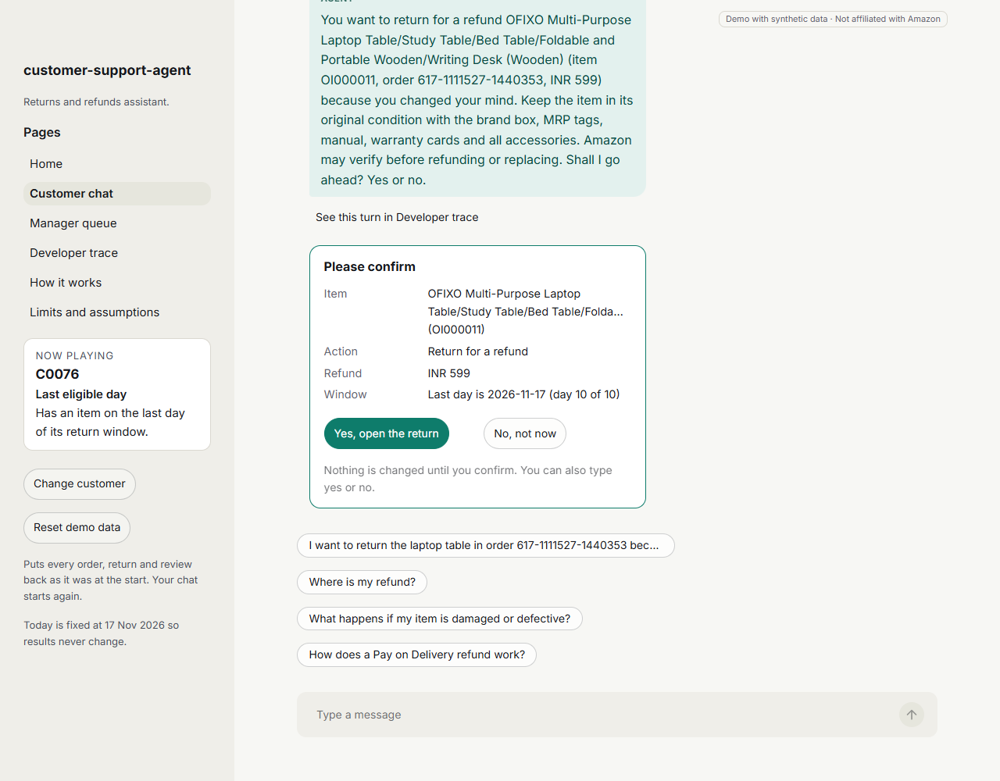
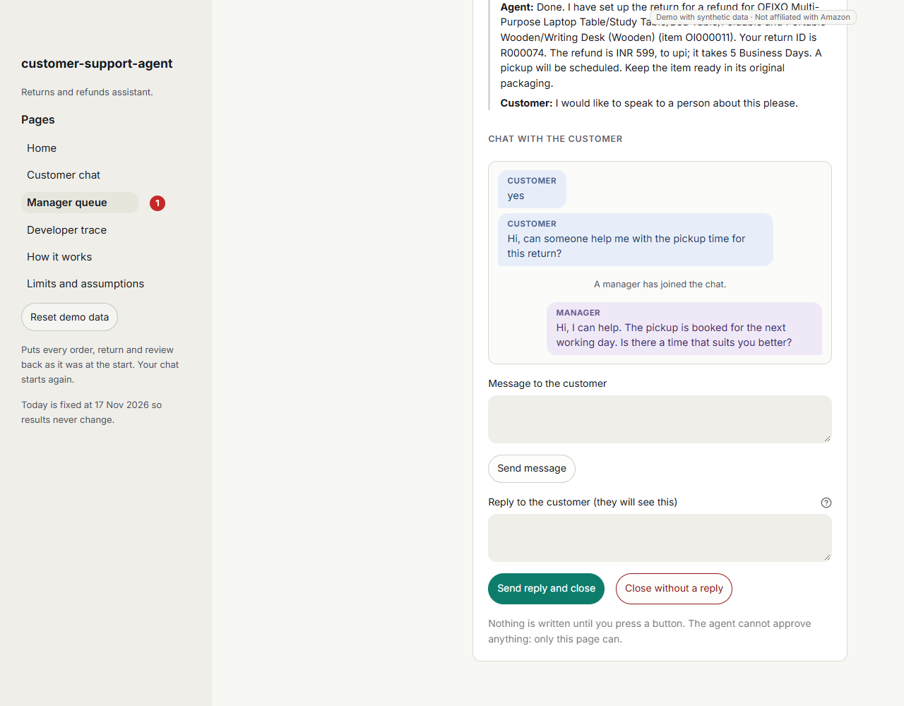
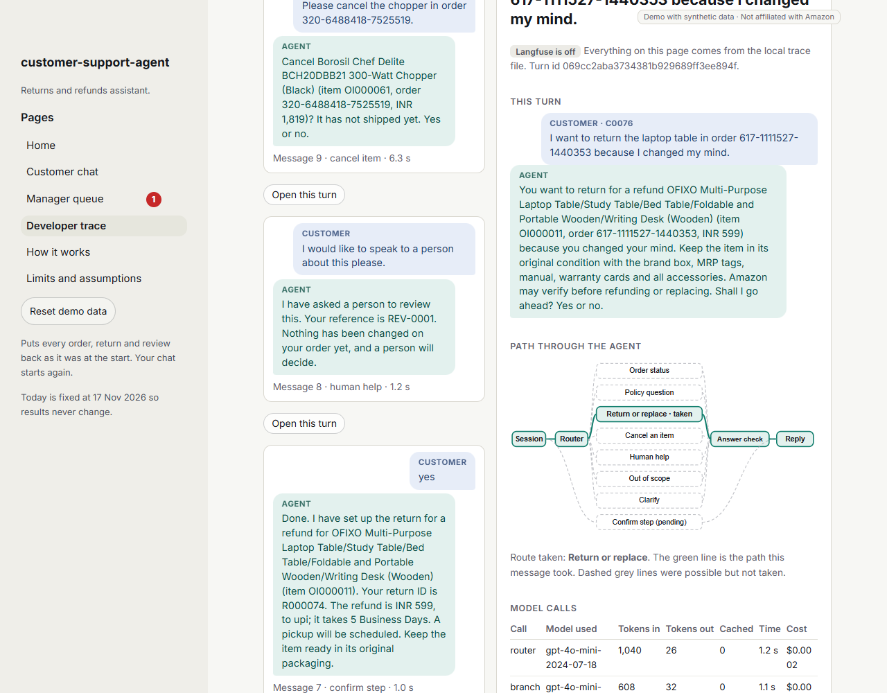
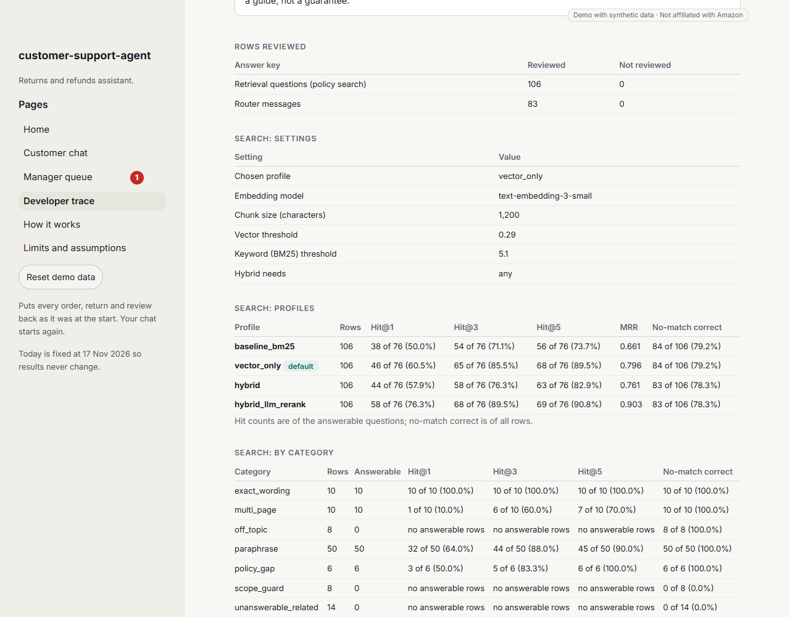
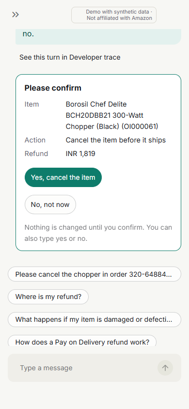
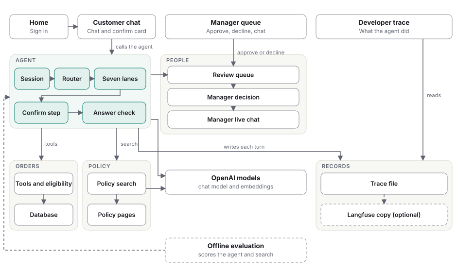

# customer-support-agent

A returns and refunds support agent for Amazon.in orders. It answers policy questions with citations, looks up orders, and returns or cancels items only after the customer confirms. It is for anyone who wants to see how an AI agent can handle money-related requests safely. This is a demo with synthetic data, not affiliated with Amazon.

Live demo: to be added.

## What it does

- Answers policy questions from the Amazon.in policy pages, with the passages it used.
- Looks up a customer's orders, delivery dates and return status.
- Starts a return, replacement or cancellation only after the customer says yes. Code checks the rules again before it writes.
- Sends exceptions (a late request, a high-value return) to a manager, who can join the chat with the customer.
- Shows every step on a Developer page: route, tool calls, passages, checks, time and tokens.

## Screenshots

| | |
| --- | --- |
|  |  |
| Home: pick a made-up customer to sign in as. | Chat: the agent asks before it changes anything. |
|  |  |
| Manager queue: a case with a live chat. | Developer trace: the path one message took. |
|  |  |
| Evaluation tab: the measured results. | Chat at phone width (390 px). |

## How it works

The model reads and writes words. Code decides eligibility, money and every change to an order.



A router sends each message to one of seven lanes. A lane can only read: look up orders, check eligibility, search the policy. When you confirm, code makes the change, and an answer check compares every number, date and file name in a reply with the tool results. The app has pages called How it works and Limits and assumptions with the details.

## Results

<!-- results:start -->
Measured on 2026-11-20 at commit `f27cb3c`, from `data/evals/summary.json`.

| What was measured | Result |
| --- | --- |
| End-to-end scenarios passed | 25 of 25 (100.0%) |
| Policy search: right page in the top 5 | 71 of 76 (93.4%) |
| Router: messages sent to the expected lane | 76 of 83 (91.6%) |

The test sets are our own, reviewed by one person, on synthetic data. The full tables are in the Evaluation tab of the Developer trace page.
<!-- results:end -->

## Run it yourself

Needs Python 3.11 or newer. On Windows use `py` if `python` is not found.

```
python -m venv .venv && .venv\Scripts\Activate.ps1          # macOS or Linux: source .venv/bin/activate
pip install -r requirements.txt -r requirements-rag.txt -r requirements-agent.txt -r requirements-app.txt
copy .env.example .env                                      # then add OPENAI_API_KEY to .env (never commit it)
python scripts/01_clean_products.py                         # then 02, 03 and 04 in order: builds data/clean and returns_agent.db
python scripts/06_build_policy_index.py                     # embeds the policy pages (calls OpenAI)
streamlit run app/main.py
```

Optional keys in `.env`: `TRACING_LANGFUSE_ENABLED`, `LANGFUSE_PUBLIC_KEY`, `LANGFUSE_SECRET_KEY`, `LANGFUSE_BASE_URL` and `LANGFUSE_HASH_KEY` turn on the Langfuse copy of the traces (`pip install -r requirements-tracing.txt`). It is off by default. The app works on a copy of the database, and "Reset demo data" puts it back.

## Tech

Python, LangGraph, Streamlit, SQLite and ChromaDB. Chat model `gpt-4o-mini` and embeddings `text-embedding-3-small` from OpenAI (both set in `config/`). 1,906 tests run with `python -m pytest`.

## Credits and licence

The data is synthetic and derived from the Kaggle "Amazon Sales Dataset" (CC BY-NC-SA 4.0), so it is shared under the same licence and this project is non-commercial. The policy text belongs to Amazon and is used for a non-commercial demonstration; keep the repository private. A licence for the code is to be added. Full credits and the list of policy pages are in [docs/SOURCES.md](docs/SOURCES.md).
